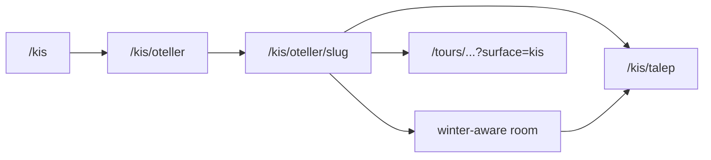
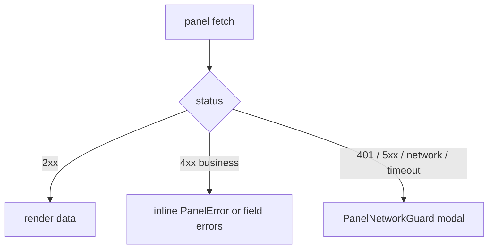

# Frontend Production Polish - Plan

## Goal Capsule

Make the existing guest, tour, and panel UIs look and behave like one product before first hotel launch.
Do not rebuild the April scaffold plan; FE-A through FE-C already ship.
Stop when winter funnels stay in season, tour gating holds for keyboard users, and panel fetch failures show retry instead of a spinner.
Do not add guest checkout, TTS, or a new i18n framework.

Authority: this plan. Parent marketplace plan (`docs/plans/hotel_marketplace_video_tours.md`) and the April frontend sub-plan remain historical; they do not reopen payments or native apps.

---

## Product Contract

### Summary

v1 web UI is feature-complete: browse, hotel, inquiry, tour player, AI guide, manager CMS, admin moderation.
The remaining work is continuity, honesty, and shared polish primitives — not new modules.
Guest uses Elite Reserve CSS; panels stay light Mantine. That split is kept.

### Actors

- A1. Guest — anonymous visitor on summer `/` or winter `/kis` funnels, plus inquiry portal and fullscreen tour.
- A2. Hotel manager — dashboard CMS and ops.
- A3. Platform admin — moderation and platform tables.

### Requirements

- R1. A winter-context guest who opens a room or inquiry stays on winter routes and winter chrome.
- R2. Room detail matches hotel-detail layout quality on mobile (stacked columns, Elite Reserve container, labeled amenities).
- R3. Shareable guest pages emit Open Graph / Twitter cards using the hotel image and short description.
- R4. Cookie consent uses Elite Reserve tokens and does not cover the winter mobile bottom nav.
- R5. Inquiry portal looks like the same product as the inquiry form (shell + Elite Reserve, not a Mantine indigo island).
- R6. Tour metadata and player chrome do not say "demo"; AI message avatars use the hotel persona, not leftover "AE".
- R7. A gated tour step cannot be skipped with Arrow keys; Continue receives focus; overlay traps focus until the guest continues or branches.
- R8. A keyboard-only guest can complete a short gated tour path in Playwright.
- R9. Manager and admin list pages show loading, empty, and retryable error via the existing `PanelLoading` / `PanelError` / `PanelEmpty` primitives.
- R10. Optimistic-lock conflict modals on property and tour editors reflect the revision that was actually loaded.
- R11. The global panel network modal fires on transport/auth/server failure, not on ordinary 4xx validation.
- R12. Wide panel tables scroll horizontally on small screens; destructive confirms use Mantine modals, not `window.confirm`.

### Scope Boundaries

In scope: guest routing/theme continuity, room/portal/consent/OG polish, tour keyboard/a11y leftovers, panel state/guard/lock/mobile IA.

Out of scope: Stripe Elements checkout, TTS, narration audio, multi-track captions, guest accounts, embedded-on-hotel-page player, full TR/EN i18n of every string, design-system unification of guest and panel.

Deferred to follow-up: dashboard nav grouping into İçerik / Satış / Raporlar; tour chrome TR/EN beyond the AI panel; `narrationUrl` playback; guest `loading.tsx` skeletons for browse/hotel.

### Assumptions

- Payments stay flagged off; "Tahsilat yakında" remains honest copy. Do not add a collector UI in this plan.
- Guest and panel keep separate visual systems (Elite Reserve vs `panel-theme.ts`).
- Fullscreen tour route stays the only guest player; no inline embed on hotel pages.

### Acceptance Examples

- AE1. From `/kis/oteller/{slug}`, room cards and inquiry CTAs stay under `/kis/...` and the dark winter shell.
- AE2. Sharing `/hotels/{slug}` shows an OG image in a link unfurl, not the site title only.
- AE3. On a gated step, ArrowRight does not advance; Tab stays inside the overlay until Continue or a branch is chosen.
- AE4. Disconnect the manager bookings API: the page shows `PanelError` with retry, not an infinite loader and not a blocking network modal for a 400.

---

## Planning Contract

### Key Technical Decisions

- KTD1. Keep two design systems. Guest Elite Reserve (`.er-*` in `apps/web/src/app/globals.css`) and panel Mantine (`apps/web/src/theme/panel-theme.ts`) stay separate. Re-skin the inquiry portal onto Elite Reserve rather than pulling Mantine into the rest of guest. (session-settled: user-approved — chosen over unifying on Mantine: guest already shipped Elite Reserve)
- KTD2. Winter continuity is a routing problem, not a second room page. Reuse the existing room route with winter-aware links/breadcrumbs/CTAs (and `/kis/oteller/.../rooms/...` aliases if a dedicated winter room URL is required for shareability). Do not duplicate room UI.
- KTD3. Do not build payment checkout. Capability-gated "yakında" copy stays. (session-settled: user-directed — chosen over Stripe Elements: v1 excludes payments)
- KTD4. Panel polish is primitive adoption, not new components. `panel-resource-state.tsx` already exists; managers that still use bare `Loader` switch to it. Tame `panel-network-guard.tsx` to ignore 4xx business errors.
- KTD5. Sequence guest → tour → panel. Guest winter leaks are launch-visible; panel density is operator-only.

### High-Level Technical Design

Winter guest flow (target):

Panel fetch error handling (target):

### Risks

- Winter room URL: if only query/surface is used, shared links from winter may land on summer chrome. Prefer path continuity (`/kis/oteller/...`) when cheap.
- Portal re-skin must keep GDPR export/erase and message thread behavior unchanged.
- Network-guard change can hide real outages if 4xx matching is too broad; whitelist validation/business codes only.

---

## Implementation Units

### U1. Winter funnel continuity

Covers R1, AE1. Depends on: none.

Keep a guest who started on `/kis` inside winter routes for hotel → room → inquiry → success.
Primary files: `apps/web/src/components/guest/guest-app-shell.tsx`, `apps/web/src/components/guest/rooms-section.tsx`, `apps/web/src/app/(guest)/hotels/[slug]/rooms/[roomSlug]/page.tsx`, inquiry CTAs on hotel detail.

Test scenarios:
- Happy: from winter hotel, room and "talep" links resolve under `/kis` and render `.er-winter`.
- Edge: summer hotel room links stay `/hotels/...` and `/inquiry`.
- Error: unknown winter hotel slug still 404s without dumping the user onto the summer home only (prefer season-aware not-found if cheap).

### U2. Guest surface polish

Covers R2–R6, AE2. Depends on: U1 for room breadcrumbs.

Room page: stack the two-column layout on small screens, use `er-container` / section rhythm, `amenityLabel()`.
Add OG/Twitter on home, browse, hotel, room.
Consent banner: CSS variables + `.er-btn`; bottom offset above winter mobile nav.
Inquiry portal: wrap in `GuestAppShell`, replace indigo Mantine island with Elite Reserve.
Strip "(demo)" from tour metadata; delete dead light `.er-winter` token block if Alpine Nocturne remains the live winter theme.

Test scenarios:
- Happy: room page at 375px stacks CTAs below content; amenities show human labels.
- Happy: hotel metadata includes `openGraph.images`.
- Edge: portal erase still confirms and anonymizes (existing portal tests updated, not deleted).
- Error: consent reject still blocks analytics (`hasAnalyticsConsent`).

### U3. Tour keyboard, focus, and leftover branding

Covers R6–R8, AE3. Depends on: none (can parallel U2).

Disable ArrowLeft/Right (and any index jump from chrome) while `pausedForInteraction`.
Focus trap + initial focus on the gated overlay.
Pass persona initials into `TourGuideMessage` instead of `"AE"`.
Add Playwright keyboard-only gated path (Space, Enter to continue, no mouse).

Test scenarios:
- Happy: keyboard-only completes a two-step gated demo tour.
- Edge: ArrowRight during gate does not change step index.
- Error: video error state still offers "Tekrar dene" and does not trap focus after dismiss.

### U4. Panel reliability primitives

Covers R9–R11, AE4. Depends on: none (can parallel U1–U3).

Adopt `PanelLoading` / `PanelError` / `PanelEmpty` on manager/admin lists that still use bare loaders (bookings, inquiries, tours, team, reviews, connectivity at minimum).
Call `lock.setRevision` on load in `property-form.tsx` and `tour-step-editor.tsx`.
`PanelNetworkGuard` skips modal for 4xx validation/business errors; keeps 401, 5xx, timeout, network.

Test scenarios:
- Happy: empty bookings list renders `PanelEmpty`.
- Error: failed bookings GET shows retry; 400 from a form submit does not open the global modal.
- Edge: 409 revision conflict still opens `PanelRevisionConflictModal` with the loaded revision.

### U5. Panel operator UX

Covers R12. Depends on: U4 (same files; land after primitives so empty/error wrappers exist).

Wrap wide tables in `ScrollArea`.
Replace `window.confirm` with Mantine confirm modals on team, tours delete, inquiry portal revoke, inventory dirty navigation, moderation delete.
Optional if time: dashboard nav groups. If not landed, leave as documented follow-up — do not block launch.

Test scenarios:
- Happy: bookings table at 375px scrolls horizontally without clipping actions.
- Happy: delete tour opens a dialog; cancel leaves the row.
- Edge: inventory dirty navigation confirm still blocks route change.

---

## Verification Contract

Repo commands live in `apps/web/package.json`. Implementers run the smallest gate that covers the unit, then the CI-equivalent before merge.

- Unit: Vitest for routing helpers, consent, persona initials, network-guard status filtering, panel revision load.
- Guest e2e: extend `apps/web/e2e/winter-journey.spec.ts` for AE1; visual specs already cover home/browse/kis.
- Tour e2e: new keyboard path next to `apps/web/e2e/smoke.spec.ts`.
- Panel: existing `apps/web/e2e/panel-lifecycles.spec.ts` plus a11y routes already in `apps/web/e2e/accessibility.spec.ts`.
- Do not require a full visual rebaseline unless U2 changes winter tokens or portal layout.

---

## Definition of Done

- R1–R12 each have a landed unit or an explicit follow-up note in this file.
- AE1–AE4 pass locally.
- `npm run test:ci` and the touched Playwright specs pass.
- No new guest Mantine islands; portal is on Elite Reserve.
- Payments UI still gated; no Stripe Elements added.
- April frontend plan is not edited except a one-line pointer at the top if useful.

Per unit:
- U1: AE1 green.
- U2: OG present; room mobile stacked; portal under guest shell; consent tokens.
- U3: keyboard e2e green; no Arrow skip; no "AE" avatar.
- U4: AE4 green on bookings at minimum; 4xx no global modal.
- U5: at least tables + confirms; nav grouping optional.

---

## Appendix

### Research notes (2026-09-16)

Guest: summer browse → hotel → inquiry is the strongest funnel. Winter home/browse is richer but room/inquiry links drop to summer. Room detail and inquiry portal are the weakest guest pages. No guest `loading.tsx` / OG images.

Tour: state machine, captions toggle, STT, token refresh, AI panel TR/EN exist. Keyboard Arrow keys bypass gates. `"AE"` avatar leftover. No keyboard-only e2e. Narration unused.

Panel: rooms/media/inventory are mature. Bookings/team/reviews still spinner-fail. Finance "yakında" is honest. Payment button when enabled creates an intent with no collector — out of this plan.

Audits: guest [Explore](9d06021d-c43d-4d86-ab4d-455c9e07b72b), tour [Explore](e86df53c-8d08-49e0-ace8-42b182f363a2), panel [Explore](d9dc4f71-7859-48a4-8e34-7a64e33fbc92).
